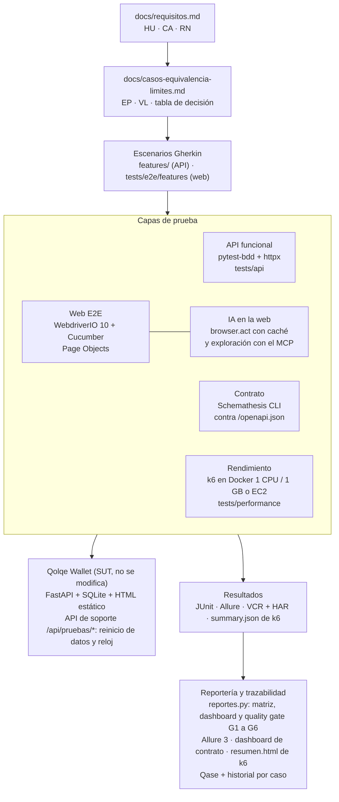
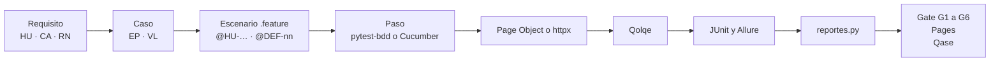
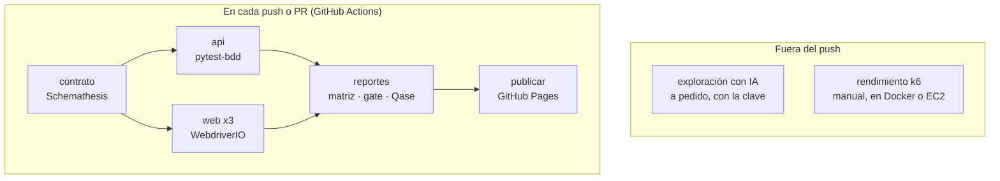

# Arquitectura del proyecto de automatización

Vista de conjunto de las tres partes (API, web con CI/CD y rendimiento): qué capas hay, qué herramienta ocupa cada una, cómo fluye un requisito hasta un reporte y qué corre dónde. La justificación detallada de cada elección está en `docs/informe.md` (§3.1 patrón de diseño, §3.2 herramientas) y en las comparativas enlazadas al final.

## 1. Vista por capas



## 2. Qué hace cada capa y por qué está

| Capa | Herramienta | Qué verifica | Qué ve que las demás no | Dónde vive |
|---|---|---|---|---|
| Requisitos y diseño | `requisitos.md`, análisis EP/VL | HU, criterios de aceptación y reglas de negocio; casos por partición de equivalencia, valores límite y tabla de decisión | Es la fuente de los casos: se hizo solo desde los requisitos y luego se contrastó con los `.feature` | `docs/` |
| API funcional | pytest + pytest-bdd + httpx | Reglas de negocio de Núcleo y G3 (más cobertura de G1, G2, G4 a G6), con Gherkin como fuente de verdad | Lógica: comisión, saldos, límites, autorización, sesión. Halló 13 de los 16 defectos | `features/`, `tests/api/` |
| Contrato | Schemathesis (CLI) | Que la API cumpla su OpenAPI: tipos, estados, esquemas y que no haya 5xx; 61 operaciones | Entradas que no se nos ocurrieron y carreras entre llamadas. Halló DEF-15 y DEF-17 | job `contrato`, `demo.py schemathesis` |
| Web E2E | WebdriverIO 10 + Cucumber + Page Objects | Los flujos en el navegador real (Chrome headless): 50 casos CP-W01 a CP-W50 más el de IA | Lo que solo existe en la interfaz: DEF-14 (zona horaria), el mensaje en pantalla, el flujo completo | `tests/e2e/` |
| IA | `@wdio/ai-service` (`browser.act`) y el MCP de WebdriverIO | Escenario `@ia` desde caché; exploración con un agente que busca defectos | Un agente sin guion ve la interfaz como un usuario; reconfirmó 4 defectos conocidos | `clasificar-ia.feature`, job `exploracion` |
| Rendimiento | k6 + Docker (CPU y memoria fijas) o EC2 | Latencia p95 por tipo de operación, fallas, integridad de datos y capacidad | Lo que depende de la carga: DEF-16 (`database is locked`), halló 1 defecto | `tests/performance/` |
| Reportería y gate | Allure 3, `reportes.py`, dashboard de contrato | Resultado de cada caso, de cada HU y el quality gate; con o sin evidencia | Junta todo: matriz HU → caso → resultado y la tendencia entre runs | `.github/scripts/`, `tests/dashboard/` |
| Trazabilidad | Matriz desde JUnit, `historial.json` y Qase | Varias ejecuciones: últimos 10 runs por caso con marca de inestable; un test run por run en Qase | Cada caso con su historia (`@HU-…`) y su defecto (`@DEF-nn`) | `docs/trazabilidad.md`, `qase.py` |

Defectos abiertos: 16 (3 críticas, 7 altas, 4 medias, 2 bajas): 13 los hallaron los `.feature` de API y web, 2 Schemathesis y 1 k6. Cada herramienta encuentra lo que las otras no pueden (`docs/comparativa-schemathesis.md` §3 y §4).

## 3. Del requisito al reporte



Las etiquetas del escenario son lo que ata las capas: `@HU-…` lo liga a su historia (matriz y gate G5) y `@DEF-nn` lo marca como defecto conocido (falla esperada: `xfail` estricto en la API; en la web, DEF-14 se corre aparte y se invierte).

## 4. Qué corre dónde



| Cuándo | Qué | Por qué ahí |
|---|---|---|
| Cada push o PR | `contrato` → `api` y `web` en paralelo → `reportes` → `publicar` | Es lo barato y determinista (unos 5 a 7 minutos). El contrato va primero: es la verificación más amplia y barata, y si la API no cumple su contrato no tiene sentido correr lo demás |
| A pedido | `exploracion` (*Run workflow*, casilla `exploracion`) | Cuesta unos US$ 0,5 por sesión y no es determinista, así que no entra al gate |
| Manual | Rendimiento (`tests/performance/correr.py`) | Una corrida de carga dura de 17 a 32 minutos y exige CPU fija para ser comparable: excede el límite de 10 minutos del gate G6 y un runner compartido no daría resultados estables. Los resultados se guardan en `tests/performance/resultados/` |
| Siempre | Publicar el sitio aunque el gate esté en rojo | Pages muestra el estado real, no el último verde |

## 5. Principios de diseño

1. **El sistema bajo prueba no se modifica.** El trabajo es probarlo, no repararlo (los defectos se documentan en `docs/defectos.md`).
2. **El `.feature` es la fuente de verdad.** Los pasos son pegamento, y las etiquetas dan la trazabilidad.
3. **Aislamiento por escenario.** Cada uno reinicia datos y reloj por la API de soporte (`POST /api/pruebas/reiniciar`), así que ningún escenario depende de otro. La API corre en el proceso (TestClient con BD temporal) o contra un servidor real con `QOLQE_URL`; la web, contra Qolqe en `:8000`.
4. **Los defectos conocidos no rompen el pipeline, pero no se esconden.** Un `@DEF-nn` es un `xfail` estricto: si el defecto se corrige y la prueba pasa, el pipeline falla para retirar la marca.
5. **Lo caro y lo no determinista queda fuera del camino de cada push.** Rendimiento y exploración con IA se lanzan aparte.
6. **La IA propone y las pruebas escritas deciden.** Un agente explora y sugiere; lo que corre en cada push son los Page Objects y los pasos deterministas.

## 6. Estructura del repositorio

```
qolqe/                  SUT (no se toca)
features/               escenarios Gherkin de la API (11 archivos)
tests/api/              pytest-bdd + httpx
tests/e2e/              web: features/, steps/ (86 pasos), pages/ (6 Page Objects), wdio.conf.js
tests/dashboard/        dashboard de contrato (Schemathesis frente a los escenarios)
tests/performance/      k6, correr.py, resultados/ con su resumen.html e index.html
.github/workflows/      pruebas.yml: el pipeline
.github/scripts/        reportes.py (matriz, dashboard y gate), qase.py, exploracion.py
docs/                   requisitos, informe, defectos, comparativas, trazabilidad
```

## Documentos relacionados

- `docs/informe.md` §3.1 (por qué Page Object y su escalabilidad) y §3.2 (cómo se complementan las herramientas)
- `docs/comparativa-schemathesis.md`, `docs/comparativa-ia.md`, `docs/comparativa-mcp-agentes.md`, `docs/comparativa-rendimiento.md`
- `docs/gestion-casos.md` (Qase frente a Kiwi TCMS) y `docs/ia-en-el-ciclo.md`
