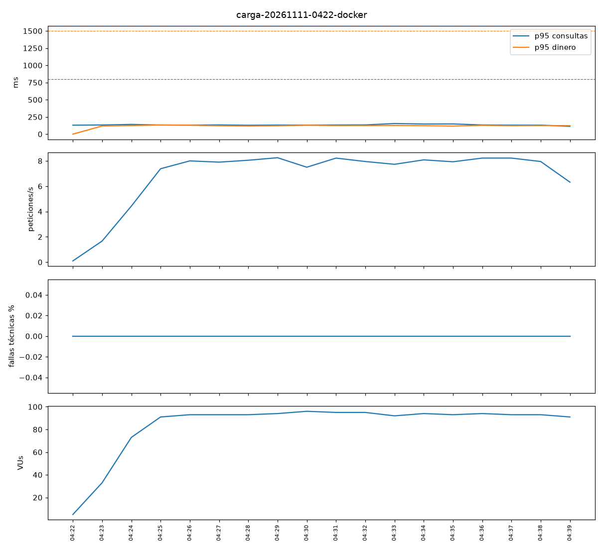
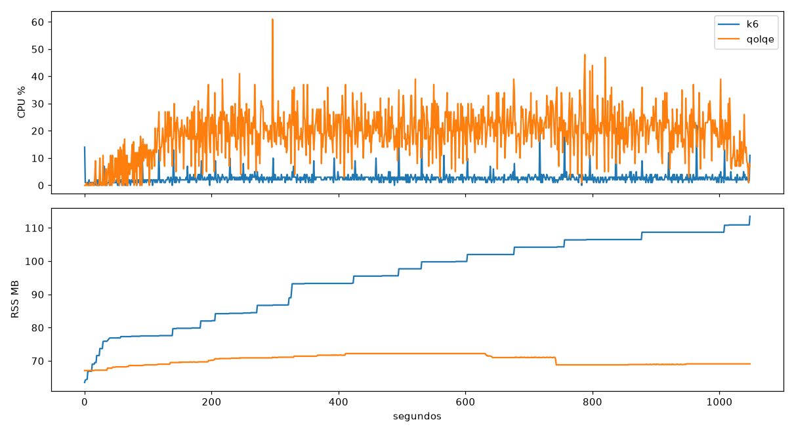
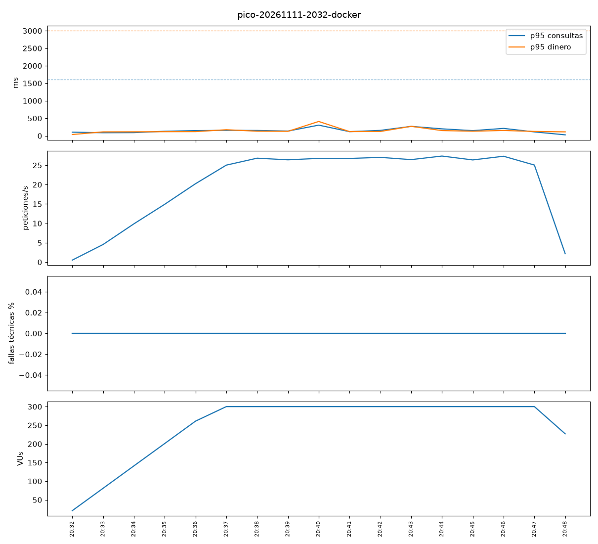
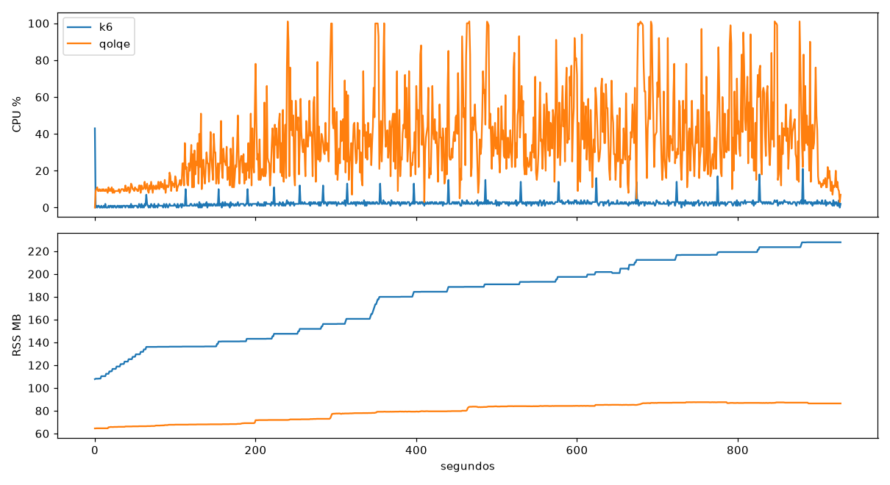
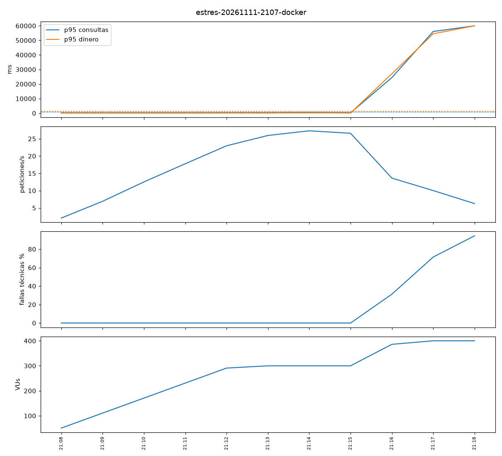
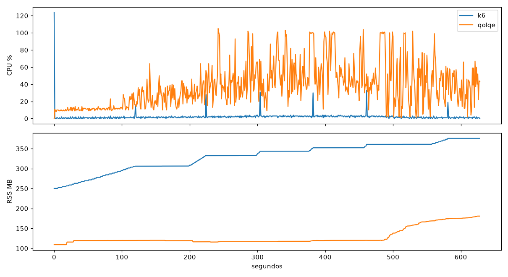
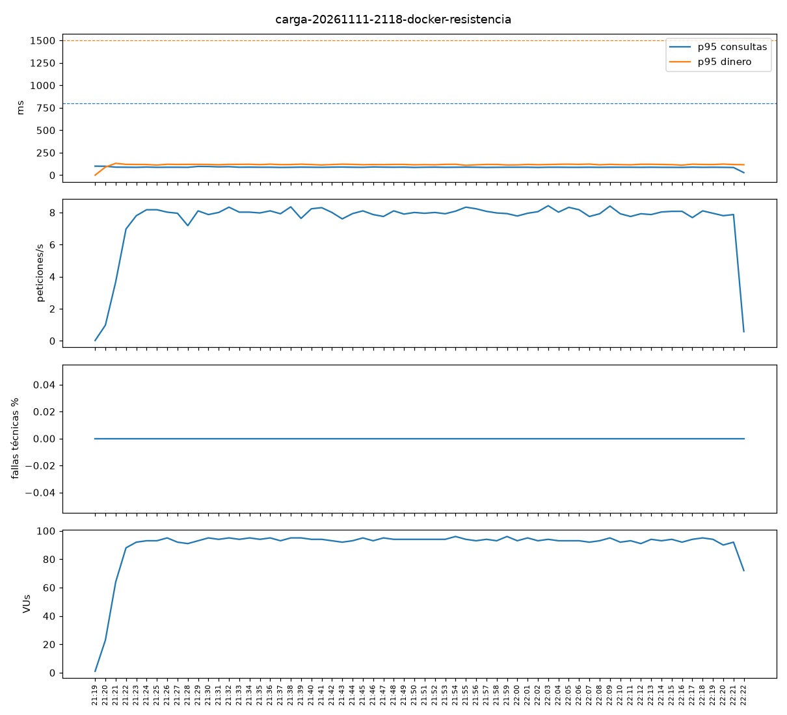
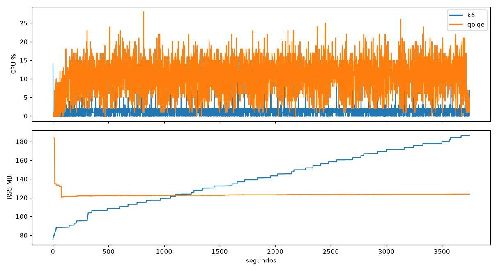
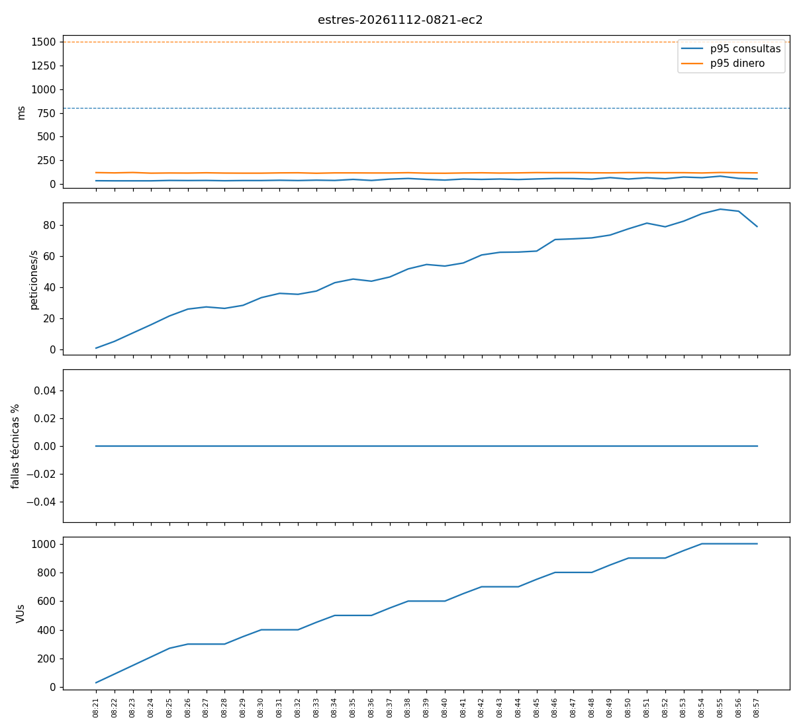
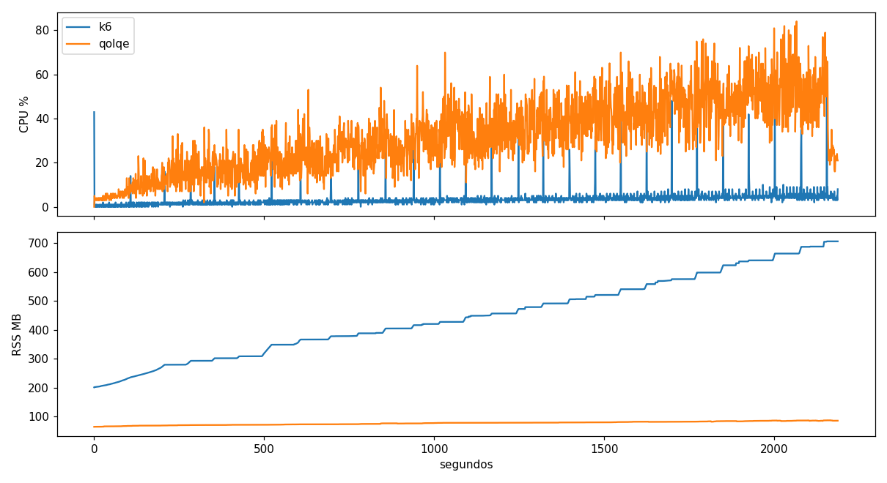

# Informe del proyecto – Grupo 3 (G3 · Historial y categorías)

## 1. Datos generales y alcance
*(Parte 1; se actualiza en cada parte)*

| Campo | Valor |
|---|---|
| Integrantes | Sebastian, Maykol |
| Módulo | G3 · Historial (filtros, paginación, exportación CSV) y categorías, más el núcleo común |
| Herramienta de API | pytest + httpx + pytest-bdd (**provisional**: la celda de la herramienta asignada está vacía en el sorteo; si cambia, los `.feature` se reutilizan tal cual) + Schemathesis para contrato |
| Herramienta web | WebdriverIO 10 + Cucumber + Page Objects + Allure; CI/CD con GitHub Actions y GitHub Pages |
| Herramienta de rendimiento | *(Parte 3)* |

**Alcance y nivel de prueba.** Se cubren **todas** las HU del núcleo (HU-N-01 a N-09) y de G3 (HU-G3-01 a G3-08), con 141 escenarios Gherkin (ver trazabilidad). Criterios para elegir el nivel:

- **API** cuando el criterio es una regla de negocio, un valor límite o un código de error: es rápido, determinista y se repite con datos independientes (`/api/pruebas/reiniciar` antes de cada escenario). Aquí se ejecutan el 100 % de los escenarios escritos, salvo uno.
- **E2E web (Parte 2)** para lo que solo existe en la interfaz: formularios, mensajes, navegación de la paginación, descarga del CSV desde el botón y el comprobante en pantalla.
- **Rendimiento (Parte 3)** para el historial con ~1,000 movimientos por usuario y la concurrencia de HU-N-07 CA5 (`@concurrencia`, omitido aquí a propósito: con un cliente en el mismo proceso no es una prueba de concurrencia real).

| HU | Prioridad | Nivel elegido | Justificación |
|---|---|---|---|
| HU-N-01 Registro | Alta | API (+ E2E el flujo del formulario) | Reglas RN-01 a RN-03 con valores límite; el SMS de bienvenida se consulta en `/api/pruebas/notificaciones` |
| HU-N-02 Login · HU-N-03 Logout | Alta | API | Bloqueo a los 3 intentos y a los 15 min (14/15 min), token 30 min, dispositivo nuevo. Seguridad: máximo riesgo |
| HU-N-04/05/06 Saldo, perfil, cierre | Alta/Media | API | Orden de validaciones del cierre (PIN → saldo → solicitudes) y efectos sobre sesiones y transferencias |
| HU-N-07/08/09 Transferencias y comisión | Alta | API | Dinero: S/ 500.00 por operación, límite diario, saldo, comisión 1.5 % con mínimo y máximo, simulador sin efectos |
| HU-G3-01 Consultar movimientos | Alta | API (+ E2E filtros y paginación en pantalla) | Rango de 90 días, tipo, categoría, páginas de 10 (9/10/11/20/21), orden y saldo posterior |
| HU-G3-02 Detalle | Alta | API | Propiedad de los datos (404 si es ajeno) |
| HU-G3-03 a 06 Categorías | Media/Baja | API | Límite de 10, nombre 3–20, paleta de 8 colores, duplicados sin distinguir mayúsculas, eliminación sin borrar movimientos |
| HU-G3-07 Clasificar | Media | API | Nota 100/101, categoría y movimiento ajenos (404), RN-11 (no cambia monto, fecha ni tipo) |
| HU-G3-08 Exportar CSV | Media | API (+ E2E la descarga) | Formato exacto del CSV, no pagina, mismas reglas de rango |

**Interpretaciones asumidas** (a confirmar con el docente): "máximo 90 días" se toma como `hasta − desde ≤ 90` días (hace 90 días → hoy es válido, hace 91 es `FILTRO_INVALIDO`); las rutas `GET /api/movimientos/recientes` y G1/G2/G4/G5/G6 quedan fuera del alcance.

## 2. Pruebas de API
*(Parte 1)*

**Herramienta: pytest + httpx + pytest-bdd.**

- **Enfoque:** los escenarios Gherkin (`features/*.feature`) son la fuente; pytest-bdd los enlaza con funciones de pasos Python (`tests/api/`). Cada `Scenario Outline` → un caso por fila de `Examples`; las etiquetas (`@HU-G3-01`, `@api`, `@DEF-07`) se vuelven marcadores de pytest y dan la trazabilidad HU → caso → resultado.
- **Ventajas:** un solo lenguaje que ya usa el repo; fixtures de pytest para aislar datos; el mismo código corre en el proceso (TestClient, sin levantar nada) o contra un servidor real con `QOLQE_URL`; `--cov` funciona directamente.
- **Limitaciones:** no trae reportes propios (hay que sumar `pytest-html`/Allure); los pasos con `parse` pueden resultar ambiguos si dos frases se parecen (nos pasó con "cambio la categoría… a nombre… y color…"); el pegamento Python crece con el número de frases.
- **Capacidades de IA:** la herramienta no incluye IA propia. Se usó un asistente (Claude Code) para proponer escenarios y pasos; ver `IA.md`.

**Contrato:** `tests/api/test_contrato.py` ejecuta Schemathesis contra `/openapi.json` de un uvicorn real en un subproceso (15 ejemplos por operación, `CONTRATO_EJEMPLOS` para cambiarlo). Se excluyen logout, sesiones, reloj, reinicio y cierre de cuenta (invalidan la sesión compartida). Se validan los checks de conformidad (sin 5xx, códigos de estado, content-type, cabeceras y esquema de respuesta) y **no** `positive/negative_data_acceptance` ni `Allow` en 405, que daban ruido: p. ej. aceptar `correo: ""` en el registro o rechazar `monto=0`, que son decisiones de negocio documentadas. **Resultado: 60 operaciones conformes** con ejemplos fijos (`derandomize`). Observación sin confirmar: en la primera corrida del CI de GitHub (semilla aleatoria, Python 3.12) Schemathesis obtuvo un `500` en `POST /api/usuarios` con `{"celular":"914710469","dni":"14710469","nombres":"00","pin":"0849","correo":"1@1.com"}`; ese cuerpo da `201` en una BD limpia y no se reprodujo en 6 corridas locales (3.12 y 3.14, hasta 100 ejemplos), así que depende del estado acumulado por la corrida de fuzzing. **No se registra como defecto** (no es reproducible); queda pendiente investigarlo con la traza del servidor.

**Corrida manual del CLI con todos los checks** (Schemathesis 4.31.1, `schemathesis run /openapi.json --max-examples 30 --checks all`, mismas exclusiones): 60 operaciones, 2 782 casos, 44 hallazgos, clasificados así: **(a) "rechazó una solicitud válida según el contrato" (23)**: el contrato es más laxo que las reglas de negocio (`monto=0` en recargas/solicitudes/comisión, categoría ajena como filtro, celular/color/tipo permitidos por el esquema pero no por la regla); es **imprecisión del contrato** (faltan `minimum`/`enum`), no defecto del código, porque las reglas están en `requisitos.md`. **(b) "aceptó una solicitud inválida según el contrato" (3)**: `pin` y `celular` más largos que `maxLength` en login/desbloqueo (responden 401/404 en vez de 422) y `cci` de tipo incorrecto en transferencias; **observaciones de bajo impacto** (el servidor igual no actúa), pendientes de decidir si se endurece el esquema. **(c) `Allow` inválido en 405 (17)**: ruido de FastAPI, no se considera defecto. **(d) "recurso no disponible tras crearlo" (1)**: por revisar. Ningún 5xx. Reporte JUnit generado localmente (no versionado).

**Cómo ejecutar** (desde la raíz del repo):

```bash
python -m venv .venv && source .venv/bin/activate
pip install -r requirements-dev.txt
pytest -rx                              # todo (≈1 min); los defectos conocidos salen como "xfailed"
pytest tests/api -m "HU-G3-01"         # una historia
MOSTRAR_DEFECTOS=1 pytest tests/api    # los defectos fallan a la vista
pytest tests/api --cov=qolqe           # cobertura
QOLQE_URL=http://localhost:8000 pytest tests/api/test_nucleo.py   # contra un servidor real
```

**Resultados** (Qolqe Wallet 1.0.0, 2026-10-17): `252 passed, 1 skipped, 24 xfailed` y 60 subpruebas de contrato. Los 24 xfailed son 24 casos que detectan los 12 defectos de la sección 5; el skipped es el escenario de concurrencia. Con `MOSTRAR_DEFECTOS=1` esos 24 fallan por el motivo descrito en `docs/defectos.md`. Cobertura de líneas de la app con estas pruebas: `api/movimientos.py` 100 %, `api/categorias.py` 100 %, `api/cuentas.py` 100 %, `api/autenticacion.py` 100 %, `reglas/nucleo.py` 100 %, `reglas/historial.py` 98 %, `api/transferencias.py` 88 %.

**Trazabilidad HU → escenarios** (cada escenario lleva su `@HU-…`; `Outline` cuenta una vez):

| HU | Archivo `.feature` | Escenarios | HU | Archivo `.feature` | Escenarios |
|---|---|---|---|---|---|
| HU-N-01 | nucleo_registro | 10 | HU-G3-01 | historial | 22 |
| HU-N-02 | nucleo_sesion | 11 | HU-G3-02 | historial | 4 |
| HU-N-03 | nucleo_sesion | 3 | HU-G3-03 | categorias | 10 |
| HU-N-04 | nucleo_cuenta | 3 | HU-G3-04 | categorias | 3 |
| HU-N-05 | nucleo_cuenta | 4 | HU-G3-05 | categorias | 8 |
| HU-N-06 | nucleo_cuenta | 7 | HU-G3-06 | categorias | 5 |
| HU-N-07 | nucleo_transferencias | 17 | HU-G3-07 | historial | 10 |
| HU-N-08 | nucleo_transferencias | 12 | HU-G3-08 | historial | 8 |
| HU-N-09 | nucleo_transferencias | 4 |  |  |  |

## 3. Pruebas web y CI/CD
*(Parte 2)*

**Herramienta web: WebdriverIO 10 + Cucumber + Page Objects + Allure** (`tests/e2e/`, README propio). Cinco casos E2E, solo para lo que existe en la interfaz (el resto se prueba por API):

| Caso | HU | Qué verifica |
|---|---|---|
| CP-W01 | HU-G3-03, HU-G3-07 | Crear categoría y clasificar el último movimiento con nota |
| CP-W02, CP-W03 | HU-G3-01 | Filtrar por tipo (Recargas, Pagos de servicios): todas las filas son de ese tipo |
| CP-W04 | HU-G3-01 | Paginar de 10 en 10 con Siguiente y Anterior ("Página 1 de 2") |
| CP-W05 | HU-G3-08 | Exportar CSV desde el botón: encabezado exacto, filas del filtro y mismos códigos que la tabla |
| CP-W90 | HU-G3-03, HU-G3-07 | El mismo flujo de CP-W01 con `browser.act()` (IA), repetido desde la caché |

Sin esperas fijas (solo `waitUntil`/`expect` con auto-espera); pasan 3 veces seguidas en local y en cada run del pipeline. DEF-14 (`@DEF-14`) corre aparte y debe fallar.

**CI/CD: GitHub Actions** (`.github/workflows/pruebas.yml`): `api` (pytest + Schemathesis, `@DEF` = xfail strict) → `web` (Qolqe en :8000, `npm test` ×3, `@ia` desde caché sin clave, DEF-14 invertido) → `reportes` (matriz + portada) → `publicar` (GitHub Pages: https://maykol-morales.github.io/cs5383-qolqe-wallet/). Quality gate: todo pasa salvo los defectos de `docs/defectos.md`. Trazabilidad: `docs/trazabilidad.md`, generada desde los JUnit de cada run.

**Comparativa de IA** (`docs/comparativa-ia.md`): para la misma tarea, Page Objects 3,6 s y 0 tokens; `browser.act` graba una vez (~137k tokens, US$ 0,29, 34 s) y repite gratis en 6,8 s; un agente Claude (`claude -p`) cuesta en cada corrida (US$ 0,36 con Sonnet 5, US$ 0,04 con Sonnet 5.5) y tarda 17–165 s. Conclusión: Page Objects para la regresión; `act` con caché versionada si se quiere escribir pasos como intención; el agente, para explorar y generar pasos, no como suite.

## 4. Pruebas de rendimiento
*(Parte 3)* · Estructura de `pdfs/Template_Informe_Rendimiento.docx`. Scripts y cómo correrlos en `tests/performance/` (README); plan y trazabilidad de cada valor en [`plan-rendimiento.md`](plan-rendimiento.md); reportes, CSV y gráficos de cada corrida en `tests/performance/resultados/<prueba>-<fecha>-<etiqueta>/`.

**Grupo:** G3 (Sebastian, Maykol) · **Fecha:** 2026-11-11 (Docker) y 2026-11-12 (EC2) · **Aplicación:** Qolqe Wallet (FastAPI + SQLite) · **Herramienta:** k6 1.3.0

### 4.1 Alcance y justificación

**Contexto de negocio.** Antes de la campaña "Quincena Qolqe" (días 15 y último de cada mes, 12:00–12:15, el triple de usuarios simultáneos que en hora punta) hay que saber si la plataforma cumple en hora punta y en el pico, y hasta cuántos usuarios simultáneos puede crecer antes de dejar de cumplir.

**Flujos críticos y criterio de selección:**

| Flujo | Peso | Criterio |
|---|---|---|
| Inicio de sesión | 1 por sesión (3 000/h) | **Frecuencia** (toda sesión pasa por aquí) y **riesgo**: PBKDF2 de 200 000 iteraciones consume CPU |
| Transferir a otro usuario Qolqe | 15 % | **Impacto en el dinero**: débito y crédito en dos cuentas; no puede quedar a medias ni duplicarse |
| Consultar movimientos | 15 % | **Riesgo**: el saldo posterior de cada fila se calcula con una subconsulta (`qolqe/api/movimientos.py:117`) |
| Consultar saldo y perfil | 30 % | **Frecuencia**: la operación más usada |
| Recargar y pagar servicios | 10 % / 4 % | **Dinero** y **riesgo**: pasan por el antifraude simulado (pausa de 40–120 ms que ocupa un hilo) |

Las demás operaciones de la tabla (contactos, consultar deudas, otras) también se ejecutan con su peso, para que la carga total sea la del requerimiento.

**Capa objetivo:** ☐ Web · ☒ **API** · ☐ Ambas. **Justificación:** el requerimiento se expresa en operaciones y tiempos de respuesta del servicio; la UI es HTML estático que llama a la misma API, así que la carga del navegador no agrega trabajo al servidor y solo encarecería el generador (un navegador por VU). La capa web ya está cubierta funcionalmente en la §3.

### 4.2 Herramienta seleccionada

**k6** (Grafana, scripts en JavaScript, motor en Go). Lo elegimos porque cada parte del requerimiento cabe en el script sin plugins:

- **Umbrales nativos** (`thresholds`) con percentiles por etiqueta: `http_req_duration{tipo:consulta}` p(95) < 800 y `{tipo:dinero}` p(95) < 1500. La corrida sale con código ≠ 0 si se incumplen, lo que sirve de quality gate.
- **Executors** que corresponden a los dos tipos de dato del requerimiento: `ramping-arrival-rate` (modelo abierto, "sesiones por hora", y `dropped_iterations` mide "sin acumular retrasos") y `ramping-vus` ("usuarios simultáneos" del pico y del estrés).
- **Generador liviano**: con 100 VUs usó en promedio 2,6 % de CPU; el enunciado invalida la corrida si pasa de ~80 %.
- `responseCallback` para que los 4xx esperados no cuenten como fallas, contadores propios (`errores_negocio` por `codigo`) y dashboard HTML exportable (`K6_WEB_DASHBOARD_EXPORT`).

| Herramienta | Ventajas frente a k6 | Limitaciones para este caso |
|---|---|---|
| **JMeter** | GUI para armar el plan, muchos plugins, protocolos no HTTP, el más conocido | Sin criterio de paso por percentil sin Taurus; modelo abierto experimental (Open Model Thread Group, 5.5); un hilo de JVM por usuario; pesos, pausa triangular e ids en Groovy dentro de un `.jmx` difícil de revisar |
| **Locust** | Python, el mismo lenguaje que el SUT y que `datos.py`; UI web en vivo | Modelo cerrado por defecto ("sin acumular retrasos" no se observa directamente); sin umbrales nativos; un núcleo por proceso |
| **Gatling** | Muy eficiente (Netty), modelo abierto nativo (`injectOpen`), `assertions` por percentil, reporte HTML muy completo; desde 2024 también en JS/TS | El umbral por tipo de operación pide agrupar peticiones; necesita Node más una JVM. Es la alternativa más cercana a k6 |
| **Artillery** | YAML simple, Node.js como el E2E, modelo abierto nativo (`arrivalRate`) | `ensure` con p95 global (por endpoint, con plugin); el generador Node, de un hilo, satura antes |
| **Taurus** | Capa YAML sobre JMeter, Gatling, Locust o k6 que agrega `passfail` | No es un generador; solo aporta umbrales, que k6 ya trae |

**Medición propia:** con el mismo escenario (100 usuarios, saldo cada 1 s, ~85 req/s), k6 usó **5,2 %** de CPU y Locust **14,0 %**, unas 2,7 veces más (`tests/performance/comparativa/`).

Comparación completa, por cada necesidad del requerimiento y con fuentes: [`comparativa-rendimiento.md`](comparativa-rendimiento.md).

**Limitaciones de k6:** el runtime JS no es Node (no hay paquetes npm, solo módulos ESM puros); no mide los recursos del servidor (lo hace `monitor.py`); la extensión de navegador no se usó. Sin GUI: el script es código y se revisa como tal.

### 4.3 Tipos de prueba seleccionados

| Tipo | ¿Aplica? | Justificación |
|---|---|---|
| Carga | ☒ Sí | "En hora punta … debe sostener el volumen de la hora punta sin acumular retrasos": 3 000 sesiones/h con los umbrales de tiempo y < 1 % de fallas |
| Estrés | ☒ Sí | "Hasta cuántos usuarios simultáneos podemos crecer antes de dejar de cumplir": escalones desde el pico hasta encontrar el quiebre |
| Pico (spike) | ☒ Sí | "El triple de usuarios simultáneos … la mayoría inicia sesión en los primeros 5 minutos": se acepta degradación razonable pero no operaciones a medias ni duplicadas |
| Resistencia (soak) | ☒ Sí, reducida | "Qolqe opera todos los días de 6:00 a 24:00 sin reinicios": se busca crecimiento de memoria o del tiempo con el volumen. Se corre 60 min en vez de 18 h (ver §4.6) |

Además, una corrida de **humo** (1 VU, 3 sesiones) valida el script y da la latencia de referencia sin contención.

### 4.4 Modelo de carga

| Parámetro | Carga | Pico | Estrés | Resistencia |
|---|---|---|---|---|
| Executor | `ramping-arrival-rate` (abierto) | `ramping-vus` | `ramping-vus` en escalones | igual que carga |
| VUs | 50 sesiones/min ≈ 100 VUs (`maxVUs` 120) | 300 | 300 → 1 000, +100 por escalón | 50 sesiones/min |
| Ramp-up (s) | 120 | 300 | 300 hasta el primer escalón, luego 60 por escalón | 120 |
| Duración (s) | 900 estables (+120 de rampa) | 900 en total (rampa incluida) | 180 por escalón (8 escalones, 2 160 en total) | 3 600 |
| Think time (ms) | triangular(10 000, 19 000, 25 000), media 18 000 | igual | igual | igual |
| Distribución (%) | saldo+perfil 30 · movimientos 15 · transferencia 15 · contactos 10 · recarga 10 · consultar deuda 6 · pagar deuda 4 · otras 10 | igual | igual | igual |

**Origen de los valores:**
- **Usuarios simultáneos** (ley de Little): 3 000 sesiones/h × 2 min / 60 min = **100**. Llegadas: 3 000/60 = **50 sesiones/min**. Campaña = triple = **300**.
- **Sesión**: login + 6 operaciones sorteadas con los pesos de la tabla, 6 pausas (después del login y entre operaciones) de media 18 s → 6 × 18 = 108 s más las respuestas ≈ **2 min**, el dato del requerimiento. La pausa es triangular(10, 19, 25) porque su media es exactamente 18 s y respeta el rango de 10 a 25 s; con 5 pausas la sesión duraría 1,5 min y no cuadra.
- **Pico**: rampa lineal de 5 min ("la mayoría inicia sesión en los primeros 5 minutos") y 15 min en total (12:00–12:15).
- **Estrés**: llega al pico (300) con la misma rampa de 5 min y sube de 100 en 100 hasta 1 000 (los usuarios preparados). Se miden los últimos 2 min de cada escalón de 3.
- **Throughput esperado**: 3 000 sesiones × 6 operaciones = 18 000 operaciones/h = **5 operaciones/s**; con ~10 peticiones HTTP por sesión (saldo+perfil y consultar+pagar son 2), **≈ 8 req/s**.

**Datos de prueba** (`tests/performance/datos.py preparar`, antes de cada corrida): `POST /api/pruebas/reiniciar` y, por SQL sobre la BD del servidor, 1 000 usuarios (los 200 de carga de la semilla y 800 copias con el mismo historial de ~1 000 movimientos), S/ 10 000 cada uno, 5 contactos y un suministro ELECTRO propio con 30 deudas. **Cada VU usa un usuario distinto** (`900000000 + VU`), así el límite diario, las 5 recargas por número o el bloqueo por PIN nunca se mezclan entre VUs. Cada operación de dinero lleva un identificador propio (descripción `k6-<vu>-<iter>-<n>`, celular destino único, `deuda_id`) para cruzarla después con la BD. No hay API para crear deudas: van por SQL, y está documentado.

### 4.5 Criterios de aceptación

| Criterio | Umbral aceptable (métrica k6) | Fuente del umbral |
|---|---|---|
| Tiempo de respuesta, consultas y login | `http_req_duration{tipo:consulta}` p(95) < 800 ms | "Consultas e inicio de sesión: el 95 % debe responder en menos de 800 ms" |
| Tiempo de respuesta, dinero | `http_req_duration{tipo:dinero}` p(95) < 1 500 ms | "Operaciones de dinero … el 95 % … en menos de 1.5 segundos" |
| Tasa de error máxima | `http_req_failed` < 1 % (5xx, timeout, red) | "En hora punta, no más del 1 % de las operaciones puede fallar" |
| Errores de datos | `errores_negocio` = 0 (4xx por regla, por `codigo`) | Enunciado §5: un 422 por regla es un problema de datos, no de rendimiento |
| Throughput mínimo | ≥ 50 sesiones/min, ≥ 5 operaciones/s (≈ 8 req/s) | 3 000 sesiones/h × 6 operaciones |
| Sin acumular retrasos | `dropped_iterations` = 0; `iteration_duration` p(95) < 130 s | "Sostener el volumen de la hora punta sin acumular retrasos" |
| Integridad | 0 operaciones a medias o duplicadas (`datos.py verificar`) | "Ninguna operación de dinero puede quedar a medias ni aplicarse dos veces" |

**Partes que no se podían convertir tal cual, y supuesto tomado:**
- **"Degradación razonable"** en el pico no tiene número: suponemos p95 ≤ 2 × el umbral (1,6 s consultas, 3 s dinero) y fallas técnicas < 5 %; la integridad sigue en 0.
- **"Operación"**: para el throughput es la operación de negocio (contador `operaciones`); el tiempo se mide por petición HTTP.
- **"Sin acumular retrasos"** se interpreta como 0 sesiones descartadas por el executor abierto con `maxVUs` 120 y duración de sesión estable.
- El historial se consulta **sin fechas** (30 días por defecto, como la pantalla de inicio). La sesión termina **sin logout** (no lo menciona).
- **Integridad** se verifica con la BD y no con la API, porque el historial de la API tiene DEF-07 y DEF-09: por usuario, saldo final − inicial = suma de los movimientos nuevos; cada transferencia con 2 movimientos y cada recarga o pago con 1; cada deuda pagada una sola vez; cruce 1:1 de las referencias que k6 registró con 2xx contra las filas nuevas.

### 4.6 Restricciones del entorno

**Dos entornos.** Las pruebas se hicieron primero en **Docker en la laptop** (plan B, mientras no aprobaban las cuentas de AWS) y se repitieron carga, pico y estrés en **AWS EC2** cuando el Learner Lab estuvo disponible (plan A). La EC2 es el entorno de referencia para la capacidad; Docker queda como **entorno restringido** (CPU lenta, disco de laptop) y es donde aparecieron el colapso y DEF-16.

**EC2 (2026-11-12):** una instancia `c7i.large` (2 vCPU Intel Xeon Sapphire Rapids, 4 GB, Ubuntu 22.04, us-east-1). En vez de dos instancias se usa **una con núcleos separados**: Qolqe en Docker con `--cpus=1 --memory=1g --cpuset-cpus=1` y k6 con `taskset -c 0`. Así no compiten por el CPU y no se suma la latencia Perú → us-east-1 (~120 ms) que tendría k6 corriendo en la laptop. Montaje en `tests/performance/README.md` ("Montaje de la EC2").

**Docker local (2026-11-11):** Qolqe corre en un contenedor `python:3.12-slim` (`tests/performance/Dockerfile`) con `--cpus=1 --memory=1g`, un solo proceso uvicorn y BD SQLite propia en `datos/rendimiento/` (puerto 8001, aparte del :8000 de las pruebas funcionales, cuyo `reiniciar` borraría a los usuarios de carga). k6 corre en el anfitrión.
**Máquina:** Surface con Intel Core i7-8650U (4 núcleos / 8 hilos, 1,9 GHz), 8 GB de RAM, Arch Linux (kernel 6.19).

**Cómo se midieron CPU y memoria:** `tests/performance/monitor.py` (el script psutil del enunciado, con PID y salida como argumentos) muestrea cada segundo el proceso uvicorn del contenedor (`docker inspect -f '{{.State.Pid}}'`, para no medir `docker-proxy`) y, aparte, el proceso de k6 → `recursos-qolqe.csv` y `recursos-k6.csv`. `correr.sh` anota la hora de inicio y fin en `horario.txt`, y `graficos.py` cruza ambos con la salida de k6. Para el cuello de botella, `py-spy record` (flamegraph) sobre el mismo proceso durante el estrés, desde un contenedor hermano con `--pid=container:qolqe-rend`.

**Limitaciones conocidas:**
- Es una **línea base relativa**, no la capacidad de producción: un núcleo limitado por cgroups en una laptop, con SQLite en un volumen local.
- El generador y el SUT comparten la máquina; se controla vigilando el CPU de k6 (2,6 % en promedio en la carga, muy lejos del 80 %).
- La latencia de red es la de localhost (el humo da la referencia sin contención).
- El reloj de Qolqe y el `reiniciar` existen solo en modo prueba (`QOLQE_MODO_PRUEBA=1`); el contenedor corre en ese modo.
- Los resultados entre entornos no se comparan: en local (Python 3.14, sin límite de CPU) la calibración salió más lenta que en Docker (Python 3.12).

**Diferencias entre el plan y la ejecución real:**
- Una sola EC2 con núcleos separados en vez de dos instancias (el Learner Lab da una sesión de ~4 h y la IP cambia al reiniciar; con núcleos fijos el generador no le roba CPU al SUT). Resistencia y prueba 3a solo en Docker: el lab no alcanzaba para 60 min más.
- **Resistencia de 60 min en vez de 18 h** (6:00–24:00): 18 h de carga no caben en el plazo ni en una laptop; 1 h a la tasa de hora punta (≈ 3 000 sesiones y ~30 000 peticiones) basta para ver tendencias de memoria y de tiempo, y la extrapolación se discute en §4.8.
- py-spy desde un contenedor hermano en vez de `sudo py-spy` (las corridas desatendidas no pueden pedir contraseña).
- **Estrés:** el primer escalón pasó de 1 a 5 min de subida, después de que la rampa de 1 min tumbara a Qolqe con 300 VUs (§4.7, prueba 3a). Esa corrida se conserva como hallazgo.
- **Estrés sin historial: no se ejecutó.** Su propósito era confirmar el historial como cuello de botella, pero la evidencia (log, CPU baja, flamegraph) apunta al candado de escritura de SQLite. El peso del historial en el CPU se lee directamente en el flamegraph.

### 4.7 Resultados

#### Humo (1 VU, 3 sesiones) · `resultados/humo-20261111-0302-prueba-script-8001/`

Todos los umbrales en verde, 0 errores de negocio, integridad OK. Tiempos sin contención (S, tiempo de servicio): login 245 ms, transferencia 114 ms (incluye el antifraude), movimientos 88 ms, el resto ≤ 15 ms.

#### Prueba 1: Carga (hora punta, 15 min) · `resultados/carga-20261111-0422-docker/`

Inicio 04:22:21, fin 04:39:52.

| Criterio | Umbral | Medido | ¿Cumple? |
|---|---|---|---|
| p95 consultas + login | < 800 ms | **133 ms** | ✅ |
| p95 dinero | < 1 500 ms | **125 ms** | ✅ |
| Fallas técnicas | < 1 % | **0 %** (0 de 7 434) | ✅ |
| Errores de negocio | 0 | **0** | ✅ |
| Throughput | ≥ 5 operaciones/s · ≈ 8 req/s | meseta **7,9–8,25 req/s ≈ 5 operaciones/s** | ✅ |
| Sin acumular retrasos | 0 dropped; sesión p95 < 130 s | **0 dropped**; sesión p95 **121 s** (media 108 s) | ✅ |
| Integridad | 0 a medias o duplicadas | **1 353 / 1 353** operaciones cruzadas, INTEGRIDAD OK | ✅ |

p95 por endpoint: login 171 ms (PBKDF2), transferencia 129 ms (antifraude), movimientos 86 ms (máx. 380 ms), recarga 28 ms, el resto ≤ 22 ms.

**Recursos:** Qolqe, CPU promedio **19 %** de un núcleo (máx. 61 %) y memoria plana **67 → 72 MB**; k6, CPU 2,6 %.




El dashboard interactivo de k6 está en `dashboard.html` de la misma carpeta.

#### Prueba 2: Pico (campaña, 300 VUs) · `resultados/pico-20261111-2032-docker/`

Inicio 20:32:37, fin 20:48:07. Rampa de 0 a 300 VUs en 5 min y 10 min estables.

| Criterio | Umbral del pico (supuesto 2×) | Umbral de hora punta | Medido | ¿Cumple? |
|---|---|---|---|---|
| p95 consultas + login | < 1 600 ms | < 800 ms | **159 ms** | ✅ ambos |
| p95 dinero | < 3 000 ms | < 1 500 ms | **137 ms** | ✅ ambos |
| Fallas técnicas | < 5 % | < 1 % | **0 %** (0 de 20 617) | ✅ ambos |
| Errores de negocio | 0 | 0 | **0** | ✅ |
| Integridad | 0 a medias o duplicadas | | **3 611 / 3 611** cruzadas, INTEGRIDAD OK | ✅ |

**Throughput** en la meseta: **26,4–27,4 req/s** (≈ 3,4 veces la hora punta, como se esperaba del triple de usuarios); 2 010 sesiones completas, sesión p95 de 120 s (la misma que en la carga: no hay cola).

**Degradación:** existe pero es leve. El p95 por minuto de las consultas sube de ~90 ms a 150–300 ms y el de dinero tiene picos de hasta 410 ms (20:40) y 271 ms (20:43). El p99 general llega a 605 ms y el máximo a 2,9 s. Lo más afectado es el **login** (p95 687 ms, máx. 2,9 s), por la concentración de inicios de sesión en la rampa y el costo de PBKDF2; le siguen movimientos (p95 278 ms, máx. 2,7 s) y transferencias (p95 159 ms, máx. 2,6 s).

**Recursos:** Qolqe, CPU **44 %** promedio en la meseta (36,5 % en toda la prueba) con ráfagas al **100 %** (27 de 540 s por encima de 95 %), lo que explica los máximos de 2–3 s. Memoria **64 → 86 MB**, sin crecer en la meseta. k6, CPU 2,4 % promedio (máx. 43 % al crear los VUs en la rampa).




#### Prueba 3a: Estrés con rampa de 1 min (colapso) · `resultados/estres-20261111-2048-docker-rampa-1min/`

Inicio 20:48:44, fin 20:51:35. La primera versión del estrés subía de 0 a 300 VUs en **1 minuto**; el pico, con los mismos 300 usuarios, sube en 5. **Qolqe colapsó a los 2 minutos** y k6 cortó la prueba (`abortOnFail`, fallas > 10 %):

| Minuto | VUs | req/s | p95 consultas | p95 dinero | Fallas |
|---|---|---|---|---|---|
| 20:49 | 300 | 18,1 | 99 ms | 117 ms | 0 % |
| 20:50 | 300 | 20,4 | 7,7 s | 11,6 s | 5 % |
| 20:51 | 300 | 6,0 | 26,5 s | 28,3 s | 60 % |

- **Fallas:** 280 de 2 751 (10,2 %): 168 respuestas **500** (login 82, recargas 41, transferencias 39, pagos 6) y 112 conexiones cortadas en el login. 0 errores de negocio.
- **Causa en el log del contenedor:** `sqlite3.OperationalError: database is locked`, **244 veces**, siempre en una escritura: `INSERT INTO sesiones` del login (`qolqe/api/autenticacion.py:136`, 139 veces) y `mover_saldo` (`qolqe/operaciones.py:23`) en transferencias y recargas (95), más los pagos (8).
- **No fue falta de CPU:** mientras la latencia subía a 10–27 s, Qolqe usó **9–14 %** de CPU (20:49:44–20:50:34). Los hilos estaban esperando, no trabajando.
- **Integridad OK:** 391 / 391 operaciones confirmadas, sin dobles. Las que fallaron con 500 hicieron rollback.
- **Flamegraph** (`flamegraph.svg`, solo muestras con CPU): `verificar_pin` (PBKDF2) se lleva el **43 %** y el historial (`listar` de `api/movimientos.py`, la subconsulta por fila) cerca del **25 %**.

**Mecanismo (hipótesis consistente con la evidencia):**
- SQLite en WAL admite **un solo escritor** a la vez.
- Cada petición abre su transacción en la primera escritura y hace `commit` en el cierre de la dependencia `obtener_bd` (`qolqe/bd.py:216`), es decir, después de la respuesta.
- Ese cierre también necesita un hilo del pool de AnyIO (40). Con 300 sesiones entrando juntas, el pool se llena de peticiones que esperan el candado (`busy_timeout` de 10 s), y quien lo tiene no consigue hilo para hacer `commit`.
- Todo se destraba recién cuando vencen los 10 s, con un 500.
- Es la misma raíz que DEF-15 (commit después de la respuesta, en la rama `final`). Se registró como **DEF-16** y se reproduce aparte con `tests/performance/reproducir_def16.py`: con más de 40 logins simultáneos aparecen los 500 (40 es el tamaño del pool).

**Consecuencia para el diseño:** con esta rampa el estrés no mide capacidad, porque se mide una avalancha de logins. El primer escalón se cambió a 5 min, como el pico (`qolqe.js`), y el estrés sin historial se descartó: la causa del colapso no es el historial.

#### Prueba 3b: Estrés (300 → 1 000 VUs, primer escalón en 5 min) · `resultados/estres-20261111-2107-docker/`

Inicio 21:08:07, fin 21:18:37. Llega a 300 VUs en 5 min (como el pico), se mantiene 3 min y sube 100 VUs por minuto. **Se quebró en el paso de 300 a 400:** k6 cortó la prueba a los 10,5 min (`abortOnFail`, fallas > 10 %).

| Minuto | VUs | req/s | p95 consultas | p95 dinero | Fallas | |
|---|---|---|---|---|---|---|
| 21:13 | 300 | 26,0 | 223 ms | 137 ms | 0 % | escalón 300 |
| 21:14 | 300 | 27,3 | 526 ms | 208 ms | 0 % | escalón 300 |
| 21:15 | 300 | 26,6 | 209 ms | 142 ms | 0 % | escalón 300 |
| 21:16 | 386 | 13,6 | 24,5 s | 27,1 s | 31 % | subida a 400 |
| 21:17 | 400 | 10,0 | 56,1 s | 54,5 s | 71 % | |
| 21:18 | 400 | 6,3 | 60,0 s | 60,0 s | 94 % | |

- **Escalón de 300 VUs: cumple** los umbrales de hora punta (p95 por minuto ≤ 526 ms en consultas y ≤ 208 ms en dinero, 0 fallas), igual que el pico.
- **Al subir a 400 se derrumba en un minuto.** El throughput cae de 27 a 6 req/s mientras los VUs suben: Qolqe deja de atender.
- **Fallas:** 1 038 de 10 319. Son 495 respuestas 500, 408 conexiones cortadas y 135 timeouts de 60 s del cliente. 0 errores de negocio.
- **Log:** 615 `database is locked` (464 en el login, `autenticacion.py:136`; 131 en `mover_saldo`). Es el mismo DEF-16 de la prueba 3a: los 100 VUs nuevos entran con login en un minuto y se suman a las sesiones que rotan.
- **Integridad OK:** 1 543 / 1 543 operaciones de dinero cruzadas.
- **Recursos:**
  - Qolqe en el escalón de 300: CPU 54 % en promedio, con ráfagas al 100 %; memoria de 117 a 120 MB.
  - Qolqe en el colapso: CPU 43 % en promedio y memoria hasta 181 MB, porque se acumulan las conexiones.
  - k6: 2,2 % de CPU en promedio.
- **Flamegraph** (`flamegraph.svg`): `verificar_pin` (PBKDF2) se lleva el **58 %** de las muestras con CPU y el historial (`listar`) el 9 %.

**Confirmación** (`resultados/estres-20261111-2222-docker-confirmacion/`, 22:23–22:34): durante la prueba 3b corrió en paralelo el reproductor de DEF-16 (21:15–21:22). Para descartar esa interferencia, el estrés se repitió con la máquina dedicada. Dio el mismo resultado:
- **Escalón de 300:** cumple (p95 por minuto de 125–217 ms en consultas y 123–205 ms en dinero, 0 fallas).
- **Subida a 400:** colapsa (p95 de 17–60 s, fallas de 16 % a 88 % por minuto; 1 112 de 10 988 en total: 627 respuestas 500, 465 conexiones cortadas y 20 timeouts).
- **Log:** 625 `database is locked`.
- **Integridad OK**, con un aviso: **1 operación de dinero se aplicó aunque k6 recibió un error o un timeout** (1 689 filas nuevas para 1 688 confirmadas). No quedó a medias ni duplicada, pero el usuario la vio fallar.

**La cifra se confirma.**




#### Prueba 4: Resistencia (60 min a la tasa de hora punta) · `resultados/carga-20261111-2118-docker-resistencia/`

Inicio 21:19:37, fin 22:22:09. Es la carga de hora punta (50 sesiones/min, modelo abierto) durante 60 min estables en vez de 15.

| Criterio | Umbral | Medido | ¿Cumple? |
|---|---|---|---|
| p95 consultas + login | < 800 ms | **88 ms** | ✅ |
| p95 dinero | < 1 500 ms | **119 ms** | ✅ |
| Fallas técnicas | < 1 % | **0 %** (0 de 29 031) | ✅ |
| Errores de negocio | 0 | **0** | ✅ |
| Throughput | ≈ 8 req/s, ≥ 5 operaciones/s | **7,7–8,3 req/s**, 4,8 operaciones/s en promedio (rampa incluida) | ✅ |
| Sin acumular retrasos | 0 dropped; sesión p95 < 130 s | **0 dropped**; sesión p95 **120 s** | ✅ |
| Integridad | 0 a medias o duplicadas | **5 288 / 5 288**, INTEGRIDAD OK | ✅ |

**Sin degradación en el tiempo:**
- **p95 por minuto:** consultas 87–97 ms y dinero 113–122 ms, del primer al último minuto.
- **Memoria plana:** **122 → 124 MB** en la hora, ≈ 2 MB/h.
- **CPU estable:** 10,6–11,5 % por cuarto de hora. k6 usó 1,2 %.
- **Historial:** con 2 985 sesiones y 5 288 operaciones de dinero nuevas, el p95 de `GET /api/movimientos` fue de 37 ms. El historial por defecto es de 30 días y los movimientos nuevos son pocos frente a los ~1 000 por usuario de la semilla.

**Lectura:**
- **Extrapolación a 18 h:** al ritmo medido serían unos 36 MB más, muy por debajo de 1 GB. No se vio nada que crezca con el tiempo (memoria, latencia, CPU).
- **Límite de la extrapolación:** 18 h reales acumulan 18 veces más movimientos, sesiones y notificaciones, y una prueba de 1 h no lo demuestra.
- **Arranque:** la memoria inicial (184 MB en el primer minuto) era la que dejó el estrés anterior en el mismo contenedor, que no se reinició. Bajó a 122 MB al empezar la corrida.




#### Validación en EC2 (carga, pico y estrés) · `resultados/{carga-20261112-0747,pico-20261112-0805,estres-20261112-0821}-ec2/`

Mismos scripts y perfiles que en Docker (`ETIQUETA=ec2`), corridos en cadena el 2026-11-12 de 07:47 a 08:57.

| Prueba | p95 consultas | p95 dinero | Fallas | Throughput | Integridad | CPU Qolqe prom. / máx. | CPU k6 | ¿Cumple? |
|---|---|---|---|---|---|---|---|---|
| Carga (100 VUs máx.) | **32 ms** | **117 ms** | 0 de 7 491 | 7,1 req/s · 4,4 operaciones/s (rampa incluida), 0 dropped | 1 350 / 1 350 OK | 5 % / 13 % | 0,8 % | ✅ |
| Pico (300 VUs) | **34 ms** | **116 ms** | 0 de 20 624 | 22 req/s promedio | 3 672 / 3 672 OK | 15 % / 37 % | 1,6 % | ✅ |
| Estrés (hasta 1 000 VUs) | **51 ms** | **117 ms** | 0 de 113 829 | meseta **87–90 req/s** a 1 000 VUs | 20 173 / 20 173 OK | 32 % / 84 % | 3,4 % | ✅ |

**El estrés no encontró el quiebre:** a 1 000 VUs (el tope del perfil) el p95 por minuto de consultas fue como máximo 81 ms, sin un solo `database is locked` ni 500. La memoria de Qolqe fue de 64 a 85 MB. El throughput creció con los usuarios hasta el final, así que el límite está por encima de 1 000 VUs.

**Por qué difiere tanto de Docker local** (allí quebraba entre 300 y 400 VUs):
- **CPU más rápido:** el login (PBKDF2, 200 000 iteraciones) baja de p95 171 ms a 36 ms en la carga. Cada login retiene un hilo y la transacción abierta mucho menos tiempo, así que es raro que más de 40 coincidan (la condición de DEF-16).
- **Disco más rápido:** el `fsync` del commit de SQLite en el volumen EBS es más corto que en la laptop, y el candado de escritura se libera antes.
- Hipótesis no verificada con flamegraph en la EC2; los dos efectos van en la misma dirección.

**DEF-16 sigue siendo un defecto:** el mecanismo (commit en el cierre de la dependencia + pool de 40 hilos) no depende del entorno, solo se vuelve menos probable con hardware rápido. Reproducirlo en la EC2 con `tests/performance/reproducir_def16.py` queda **pendiente**.




### 4.8 Análisis, conclusiones y recomendaciones

**Predicción antes del estrés** (ley de utilización U = X · S). En la carga, ≈ 8 req/s usaron ≈ 19 % de un núcleo → unos 24 ms de CPU por petición. Con 1 núcleo el servidor se satura cerca de **42 req/s ≈ 4,2 sesiones/s ≈ 15 000 sesiones/h ≈ 5 veces la hora punta**, que por Little son unos **500 usuarios simultáneos**. El pico (300 VUs ≈ 25 req/s) debería quedar cerca del 60 % de CPU y cumplir; el estrés debería quebrar entre 400 y 500 VUs.

**¿Se cumplieron los umbrales?** En hora punta, **sí, con amplio margen**: el p95 está a la sexta parte del umbral y no hubo fallas ni retrasos. En el **pico de la campaña también**, incluso con los umbrales estrictos de hora punta (no hizo falta la tolerancia de 2×), y sin ninguna operación de dinero a medias ni duplicada. La predicción del 60 % de CPU en el pico sobrestimó: se midió 44 %, así que el costo de CPU por petición baja con la carga (≈ 16 ms frente a 24 ms; probablemente porque en la carga, con solo 19 % de CPU, el consumo fijo del proceso pesa más). En el **estrés**, los umbrales se cumplen hasta **300 VUs** y dejan de cumplirse al subir a **400**: en un minuto el p95 pasa de ~0,2 s a 24–27 s y las fallas a 31 %. En la **EC2** carga, pico y estrés cumplen todo, el estrés hasta 1 000 VUs sin quebrar. En la **resistencia** (60 min de hora punta) se cumplen todos, sin degradación con el tiempo: p95 y memoria planos (122 → 124 MB).

**Cuello de botella, con evidencia:** las hipótesis del plan eran: (1) `GET /api/movimientos` con una subconsulta por fila; (2) el pool de 40 hilos de AnyIO ocupado por el antifraude y PBKDF2; (3) CPU del login (PBKDF2). SQLite en WAL se consideraba poco probable. **Las pruebas 3a y 3b desmintieron eso último:** en los dos colapsos la causa es `database is locked` (244 y 615 veces en el log) combinado con el pool de hilos (hipótesis 2), registrado como **DEF-16**: el reproductor muestra que con más de 40 logins simultáneos aparecen los 500. El CPU estaba lejos de saturarse (9–14 % en el colapso de la 3a). En CPU, los flamegraphs muestran el login (43–58 %) y el historial (9–25 %).

**Patrón de degradación (Docker local; en la EC2 no hubo degradación hasta 1 000 VUs):** no es gradual sino un **acantilado**.
- Hasta 300 VUs el p95 sube poco (de ~90 ms a 200–500 ms por minuto) y no hay fallas.
- Por encima, la latencia salta a decenas de segundos y el throughput cae en vez de crecer.
- La predicción por CPU (U = X · S, ~500 usuarios) **sobrestimó la capacidad**, porque el recurso que se agota no es el CPU (54 % en el último escalón sano) sino el candado de escritura de SQLite junto con el pool de 40 hilos (DEF-16).
- El CPU sí explica la lentitud del login: PBKDF2 es el 43–58 % del flamegraph.
- El historial, la sospecha principal del plan, pesa solo el 9–25 % del CPU y no aparece en el colapso.

**Capacidad estimada (EC2, entorno de referencia):** **al menos 1 000 usuarios simultáneos ≈ 30 000 sesiones/h ≈ 10 veces la hora punta**, con todos los umbrales de hora punta cumplidos y 0 fallas. Es una cota inferior: el perfil terminaba en 1 000 y no se llegó al quiebre. Con CPU promedio de 32 % (máx. 84 %) en el último escalón, el siguiente límite probable es el CPU del login.

**Capacidad en el entorno restringido (Docker local):** **300 usuarios simultáneos ≈ 9 000 sesiones/h ≈ 3 veces la hora punta**, si se sube con una rampa como la del pico. Es el último escalón que cumple los umbrales; el siguiente medido (400) los incumple. Se confirmó con una segunda corrida dedicada (mismo quiebre). Entre 300 y 400 no se afinó: el quiebre depende de cuántos logins llegan a la vez más que de un número fijo de usuarios (DEF-16), así que una cifra más fina daría una precisión engañosa.

**Riesgos para el negocio:**
- **El margen depende del hardware.** En la EC2 la campaña (300 usuarios) ocupa menos de un tercio de la capacidad medida; en un servidor como la laptop cabría justo en el límite. El margen viene del CPU y el disco, no de la aplicación: DEF-16 sigue ahí.
- **Lo que tumba a Qolqe es cómo llegan los usuarios, no cuántos.** La misma cantidad (300) que entra en 5 min pasa, y entra en 1 min colapsa. Basta que más de 40 personas inicien sesión en el mismo instante para que parte reciba un 500 (DEF-16). Una notificación push de la campaña que haga entrar a todos a la vez es justo ese escenario.
- **Un colapso deja de atender a todos**, no solo a los nuevos: las consultas de saldo también llegan a 60 s.
- **El dinero no se pierde, pero puede parecer perdido:** en todas las pruebas, incluidas las que colapsaron, la integridad fue OK, porque los 500 hacen rollback. En el colapso de la confirmación, una operación se aplicó aunque el cliente recibió un timeout. Si el usuario la reintenta, se cobra dos veces: la API no tiene clave de idempotencia. El riesgo es de disponibilidad y de reintentos, no de saldos corruptos.

**Acciones recomendadas** (para el equipo de Qolqe; este proyecto no modifica `qolqe/`):
1. **Corregir DEF-16 y DEF-15:** hacer `commit` dentro del endpoint y no en el cierre de la dependencia, y acortar las transacciones (escribir solo al final, después del antifraude y de los cálculos). Es el cambio con más impacto en la capacidad.
2. **No responder 500 por contención:** con candado ocupado, 503 con `Retry-After`, y que la app reintente con espera aleatoria. Para que reintentar sea seguro, una **clave de idempotencia** en transferencias, recargas y pagos.
3. **Escalonar la entrada en la campaña:** notificaciones por tandas y una cola o sala de espera para el login.
4. **Medir de nuevo después del cambio:** con el candado resuelto, el siguiente límite será el CPU del login (PBKDF2, la mitad del CPU). Se puede mover el hash a un proceso aparte o escalar horizontalmente, con un motor de BD que admita varios escritores (PostgreSQL) si se usa más de un proceso.
5. **Historial:** precalcular el saldo posterior en vez de una subconsulta por fila. No es urgente, porque pesa menos del 25 % del CPU.

## 5. Defectos encontrados
*(Todas las partes)* · Detalle, pasos y evidencia en [`defectos.md`](defectos.md).

| ID | Título | Severidad | Estado |
|---|---|---|---|
| DEF-01 | La comisión interbancaria no usa redondeo comercial (0.005 no sube) | Media | Abierto |
| DEF-02 | El PIN con secuencia descendente (4321, 9876, 3210) se acepta al registrarse | Media | Abierto |
| DEF-03 | Un inicio de sesión exitoso no reinicia el conteo de intentos fallidos | Alta | Abierto |
| DEF-04 | Una transferencia interbancaria puede dejar el saldo negativo | Crítica | Abierto |
| DEF-05 | Cerrar sesión responde 204 pero el token sigue siendo válido | Crítica | Abierto |
| DEF-06 | Se puede transferir a una cuenta cerrada y el dinero se pierde | Crítica | Abierto |
| DEF-07 | El historial excluye el día completo de `hasta`, incluidos los movimientos de hoy | Alta | Abierto |
| DEF-08 | El detalle de un movimiento de otro usuario es visible (200 en lugar de 404) | Alta | Abierto |
| DEF-09 | El destinatario de una transferencia ve el movimiento del emisor en el detalle | Media | Abierto |
| DEF-10 | Editar una categoría permite repetir el nombre de otra categoría | Baja | Abierto |
| DEF-11 | El token deja de ser válido a los 30 minutos exactos | — | Descartado (el requisito no precisa el minuto 30; se acepta el comportamiento) |
| DEF-12 | Dos operaciones del mismo usuario en el mismo segundo comparten el código de operación | Alta | Abierto |
| DEF-13 | El límite diario no cuenta las transferencias interbancarias | Alta | Abierto |
| DEF-14 | De noche en Lima, con el celular en otra zona horaria, el historial sale vacío (UI, Parte 2) | Media | Abierto |
| DEF-16 | Con más de 40 inicios de sesión a la vez, Qolqe responde 500 «database is locked» (rendimiento, Parte 3) | Alta | Abierto |

## 6. Conclusiones y recomendaciones
*(Entrega final)*
